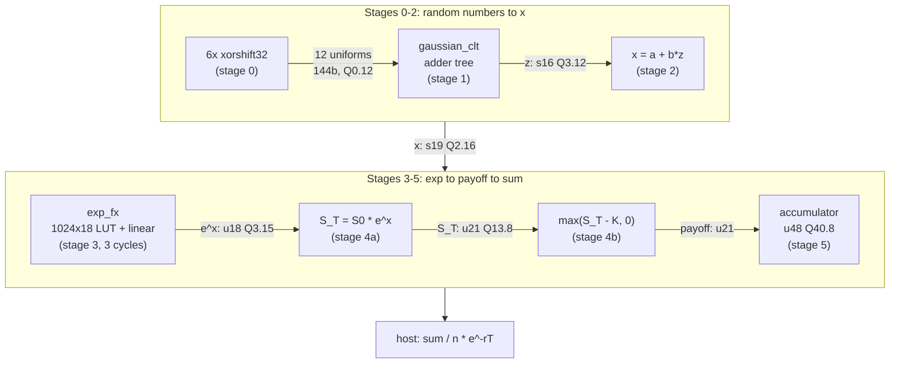

# Pipelined Monte Carlo Option Pricer in SystemVerilog

A fixed-point, fully pipelined hardware Monte Carlo pricer for European call options. One lane simulates **one price path per clock cycle**, end to end (random numbers → Gaussian → exp → payoff → accumulate). The RTL is verified **bit-exact** against a Python golden model, and its price is checked against the closed-form Black-Scholes value.

Synthesized for a Lattice ECP5-85F with the open-source Yosys + nextpnr flow, a single lane closes at **89.1 MHz (~89 M paths/s)**. That's up from a 61.6 MHz baseline after two rounds of critical-path-driven pipelining, with **+45% throughput for 69 extra flip-flops**.

**Why hardware?** The Monte Carlo error shrinks as 1/√n, so every extra digit of accuracy costs **100× more paths**. Each path is independent and does the same short sequence of math, which makes it a throughput problem that suits a deep pipeline and parallel lanes.

---

## Pipeline



The host precomputes two constants, `a = (r − σ²/2)T` and `b = σ√T`. The hardware then runs only the per-path inner loop, `S_T = S0 · exp(a + b·Z)`, `payoff = max(S_T − K, 0)`, and the host divides the final sum by n and discounts. Every stage carries a `valid` bit alongside its data, so pipeline bubbles never reach the accumulator. Latency from issue to accumulate is 8 cycles. Throughput is 1 path per cycle.

| Module | Role |
|---|---|
| `rtl/xorshift32.sv` | 32-bit xorshift RNG (shift/XOR only, period 2³² − 1) |
| `rtl/gaussian_clt.sv` | Sums 12 uniforms − 6 → approx. N(0,1) with adders only (4-deep adder tree) |
| `rtl/exp_lut.sv` | 1024 × 18 table of e^x, **auto-generated** by `model/gen_exp_lut.py` |
| `rtl/exp_fx.sv` | e^x = T[x_hi] · (1 + x_lo), table lookup + one multiply, 3-stage pipeline |
| `rtl/mc_lane.sv` | Full lane: RNGs → Gaussian → exp → payoff → accumulator, plus start/done control |

---

## Results

### Price (RTL simulation vs. Black-Scholes)

S0 = K = 100, r = 5%, σ = 20%, T = 1 year. Black-Scholes = **10.4506**.

| | Price | Notes |
|---|---|---|
| RTL simulation, 100k paths (one seed set) | 10.5422 | +0.092, about 2.0 standard errors (SE = 0.047) |
| Bit-exact hardware model, 8 seed sets × 200k paths | **10.4645 ± 0.0119** | 1.2 SE from Black-Scholes, so no detectable bias |

A single Monte Carlo run is random, so the multi-seed average is the honest accuracy figure.

### Synthesis: Lattice ECP5-85F (LFE5U-85F, CABGA381)

Yosys + nextpnr (OSS CAD Suite), out-of-context (core logic only; the lane's ~360 I/O bits exceed the package pins).

| Version | Fmax | LUT4 | FF | DSP (18×18) | BRAM | Critical path |
|---|---|---|---|---|---|---|
| Baseline | 61.6 MHz | 1,109 | 376 | 4 | 1 | exp: BRAM read → multiply → 2 adders, all in one cycle |
| + pipelined `exp_fx` (2 regs after table) | 72.6 MHz | 1,099 | 423 | 4 | 1 | S0 × e^x → round → compare → subtract |
| + split payoff stage | **89.1 MHz** | 1,104 | 445 | 4 | 1 | exp: multiply → 2 adders (11.2 ns, ~40% routing) |

The final lane uses about 1.3% of LUTs, 0.5% of flip-flops, 2.6% of DSPs and 0.5% of block RAM.

**Scaling (estimate, not measured):** DSPs are the limiting resource at 4 per lane out of 156, so about 39 lanes would fit, on the order of 3 billion paths/s. In practice, Fmax typically drops as a device fills.

---

## Design decisions

### Bit widths

Widths were chosen with a fixed-point sweep in `model/explore_widths.py`. Integer bits come from each signal's worst-case range. Fraction bits come from the error budget, then get rounded up to the 18-bit DSP input width where a signal feeds a multiplier.

| Signal | Format | Bits | Reason |
|---|---|---|---|
| uniforms (×12) | unsigned Q0.12 | 12 | 12 × 12-bit sum fits exactly in Z's 16 bits |
| Z | signed Q3.12 | 16 | CLT range is [−6, 6) |
| a, b (constants) | signed Q3.20 | 24 | constant rounding is a bias every path inherits (see below), and it's loaded once, so nearly free |
| x | signed Q2.16 | 19 | headroom over \|x\| < 2 |
| e^x | unsigned Q3.15 | 18 | most sensitive per-path signal (×S0 amplifies its error), fills one DSP input |
| S0, K | unsigned Q10.8 | 18 | 8 fraction bits is plenty at price scale, one DSP input |
| S_T, payoff | unsigned Q13.8 | 21 | full product range, no overflow |
| accumulator | unsigned Q40.8 | 48 | worst case up to about 2³⁰ paths without overflow |

### Findings from the fixed-point sweep (1M paths, compared to float with the *same* random numbers)

| Fraction bits | Quantization error |
|---|---|
| 8 | 0.0369 |
| 10 | 0.0267 |
| **12** | **0.0005** |
| 14 | 0.0025 |
| 16 | 0.0002 |

- **Precision is matched to the noise floor.** At 12 fraction bits, rounding error is about 28× below the Monte Carlo standard error at 1M paths (0.0147). More bits buy nothing measurable and cost area and Fmax.
- **More bits gave *more* error (14 vs. 12).** Per-path rounding averages out over a million paths, but the constants `a` and `b` are rounded once and reused by every path, so their error is a **bias** that never averages out. At 14 bits both rounded upward (+0.0023 predicted from price sensitivity, +0.0025 measured). At 12 bits their errors happened to cancel. The fix was giving the constants extra bits.

### Gaussian: sum of 12 uniforms

A uniform on [0, 1) has variance 1/12, so the sum of 12 has variance exactly 1, with no multiply needed. Subtracting 6 centers it. In hardware it's a 4-deep tree of 11 adders, compared with the ln, sqrt and cos that the exact Box-Muller method needs. The trade-off is that tails are clipped to ±6 (true probability beyond that is about 2 × 10⁻⁹), which has no measurable effect on the price.

### exp unit: table + linear correction

Split x into a coarse part and a fine part: e^x = e^(x_hi) · e^(x_lo) ≈ T[x_hi] · (1 + x_lo).

- `x[17:8]` indexes a **1024 × 18 table = 18,432 bits, exactly one ECP5 18 Kb block RAM**. One more index bit would need two blocks for about 1 LSB less error.
- `x[7:0]` < 1/256, so the linear term is accurate to about 2⁻¹⁷.
- Worst-case error over all x ∈ [−2, 2): **2.61 LSB** (7.97 × 10⁻⁵). Effect on price: about 0.0002.
- **Rounding, not truncation:** truncating the correction term biases every result downward, giving 5× more price error (0.0010 vs. 0.0002).
- An `out_of_range` flag catches |x| ≥ 2 instead of silently returning garbage.
- The table is generated from the same Python source as the golden model, so hardware and model can't disagree.

### Pipelining, driven by the critical path

1. The baseline's critical path was the BRAM read (5.6 ns clock-to-out) → multiply → two adders in one cycle. Adding **two** registers after the table was required: Yosys absorbs the first into the BRAM's own (slow) output register, so the second, a fabric flip-flop, is what actually cuts the path. Result: 61.6 → 72.6 MHz.
2. The bottleneck moved to the payoff stage (multiply → round → compare → subtract). Splitting it in two: 72.6 → 89.1 MHz.
3. The remaining limit is the DSP multiply plus adders and routing. Further pipelining gives diminishing returns.

---

## Verification

Every RTL block is checked **bit-exact** against a Python reference model with [cocotb](https://www.cocotb.org/) on Verilator. The hardware must produce the identical integer, not an approximately equal one.

| Test | What it checks |
|---|---|
| `test_xorshift32` | 1,000 consecutive outputs vs. Python model |
| `test_gaussian_clt` | corners (all-0 → −6.0, all-max → just under +6.0, midpoint → 0) + 1,000 random inputs |
| `test_exp_fx` | table-boundary corners + 2,000 random x, out-of-range flag, and accuracy vs. `math.exp` (2.61 LSB) |
| `test_mc_lane` | 2,000-path sum bit-exact vs. model, rerun reproducibility, and 100k-path price within 4 SE of Black-Scholes |

- Tests are latency-agnostic (they wait on `valid`/`done`), so pipeline depth can change without rewriting them.
- Random tests use fixed seeds, so any failure reproduces exactly.
- `verilator --lint-only -Wall` is clean. The intentional waivers (deliberately dropped low bits) are commented inline.

---

## Repository layout

```
model/
  golden.py           Black-Scholes, float MC, bit-exact models of every RTL block
  explore_widths.py   fixed-point sweep used to choose bit widths
  gen_exp_lut.py      generates rtl/exp_lut.sv from the golden model's table
rtl/                  SystemVerilog (one module per file)
tb/                   cocotb tests + shared Makefile
synth/synth.ys        Yosys synthesis script
```

## How to run

**Simulation** (macOS: `brew install verilator`):

```bash
python3 -m venv .venv && source .venv/bin/activate
pip install -r requirements.txt
cd tb
make TOP=mc_lane          # also: xorshift32, gaussian_clt, exp_fx
```

**Regenerate the exp table** (after changing the model):

```bash
cd model && python gen_exp_lut.py
```

**Synthesis** (needs [OSS CAD Suite](https://github.com/YosysHQ/oss-cad-suite-build); use a separate shell from the venv):

```bash
source ~/tools/oss-cad-suite/environment
yosys -q -l synth/yosys.log synth/synth.ys
nextpnr-ecp5 --85k --package CABGA381 --json synth/mc_lane.json \
    --out-of-context --freq 100 -l synth/pnr.log
grep "Max frequency" synth/pnr.log | tail -1
```

Tools used: Verilator 5.052, cocotb 2.1.0, Yosys 0.69, nextpnr-ecp5.

---

## Next steps

- **Multiple lanes** with a reduction tree, measuring how Fmax holds up as the device fills
- **Pipeline the remaining multiply → add paths**, or map them onto the DSP's internal registers
- **A host interface** (UART or a register bus) to run on a physical ECP5 board
- **Variance reduction** (e.g., antithetic variates: reuse −Z) for more accuracy per path
